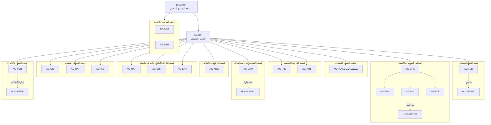

# الهيكل التنظيمي النهائي لإدارة البحوث التراثية

> **الوثيقة:** 01 · **النطاق:** الوحدات، والوكلاء العشرون، والأدوار البشرية، وخطوط التبعية، وحقوق القرار عبر دورة المشروع ذات المراحل الست عشرة.
> **حالة الوثيقة:** مُصمَّم (الهيكل) · مُنفَّذ جزئياً (بطاقات الوكلاء وحزم التلقين وضوابط الصلاحيات في التطبيق).

---

## 1. المنطلقات التنظيمية

يقوم هذا الهيكل على ثلاثة مبادئ حاكمة لا يُتنازل عنها:

1. **الفصل بين الإنتاج والتحقق:** لا يُجيز الوكيلُ الذي أنتج مادةً بحثيةً مادتَه بنفسه؛ فالتحقق من المصادر موكول إلى وحدة النزاهة والجودة، والاعتماد النهائي موكول إلى إنسانٍ مخوَّل.
2. **الحدّ الأدنى من الصلاحيات:** لكل وكيل ما يحتاجه من قراءة وكتابة في الجداول والأدوات، لا أكثر، كما تعلنه بطاقته؛ فالمؤرشف (AG-ARC) وحده يُعلَن كاتباً في جدول الأصول، ومسؤول الأخلاقيات (AG-ETH) وحده يُعلَن كاتباً في جدول الأذونات (التفصيل وحدود التطبيق في الوثيقة 02).
3. **السيادة البشرية على القرار:** الوكلاء الآليون يقترحون ويُعدّون ويدقّقون، أما القرار الملزم في بوابات الجودة الحاسمة (الأخلاقيات، والتحكيم، والتدقيق القانوني، والاعتماد، والنشر) فيصدر عن دورٍ بشري مسمّى.

## 2. الوحدات التنظيمية

| الرمز | الوحدة | المهمة المؤسسية | الوكلاء المنتسبون | اللون التعريفي |
|---|---|---|---|---|
| U-01 | مكتب المدير التنفيذي | القيادة البحثية، التخطيط، تحليل الفجوات، إدارة المحفظة | AG-DIR، AG-PLN | `#1F4E79` |
| U-02 | قسم التاريخ والمجتمع | التأريخ الاجتماعي، والإثنوغرافيا، وتفسير البنى الاجتماعية | AG-HIS، AG-ANT | `#A0522D` |
| U-03 | قسم الجمع الميداني | تخطيط الجمع وتنسيق المقابلات والملاحظة والمسوح | AG-FLD | `#3E7C3A` |
| U-04 | المختبر السمعي واللغوي | نقد الرواية الشفهية، والتفريغ، واللهجات والمعجم، والشعر والأهازيج | AG-ORL، AG-TRN، AG-DIA، AG-PTR | `#0E7C86` |
| U-05 | قسم الأرشيف والوثائق | الحفظ، والفهرسة، ونقد الوثائق والمخطوطات، وإدارة خزنة الأصول | AG-ARC | `#6B4E2E` |
| U-06 | قسم التراث المادي والحرف والبيئة | العمارة، والأشياء، والحرف، والاقتصاد التقليدي، والتراث الطبيعي | AG-MAT، AG-CRF، AG-ENV | `#B8860B` |
| U-07 | قسم التشريعات والسياسات | رصد الإطار القانوني وسياسات الصون ومواءمتها | AG-LAW | `#5B3A7A` |
| U-08 | وحدة التحليل المتقدم | نظم المعلومات الجغرافية، والإحصاء والمسوح، وتحليل الصور والإنتاج البصري | AG-GIS، AG-DAT، AG-VIS | `#5BA4CF` |
| U-09 | وحدة النزاهة والجودة | تدقيق المصادر والأدلة، والأخلاقيات والحقوق والخصوصية | AG-SRC، AG-ETH | `#8B1E3F` |
| U-10 | وحدة النشر والإخراج | التحرير العلمي، وإدارة التحكيم، والإخراج والنشر | AG-PUB | `#12263F` |

## 3. الوكلاء العشرون: التكليف والتبعية

| المعرّف | الاسم | الوحدة | يرفع تقاريره إلى | المسؤولية الجوهرية | ما لا يملكه |
|---|---|---|---|---|---|
| AG-DIR | المدير التنفيذي للإدارة | U-01 | HUM-DIR | توجيه المحفظة، فتح المشاريع وإغلاقها، تنسيق الوحدات | لا يعتمد النشر منفرداً |
| AG-PLN | مخطِّط البحوث ومحلل الفجوات | U-01 | AG-DIR | صياغة المشكلة والفجوة وخطة البحث | لا يجمع ميدانياً |
| AG-HIS | المؤرخ الاجتماعي | U-02 | AG-DIR | النقد التاريخي والسياق الاجتماعي والاقتصادي | لا يحسم تعارض الأدلة منفرداً |
| AG-ANT | الأنثروبولوجي والإثنوغرافي | U-02 | AG-DIR | الملاحظة المشاركة وتحليل الممارسات | لا يقرر صلاحية الموافقة |
| AG-FLD | منسّق الجمع الميداني | U-03 | AG-DIR | جداول الجمع، توزيع الباحثين، ضبط الاستمارات | لا يبدأ جمعاً قبل بوابة S06 |
| AG-ORL | محقِّق الروايات الشفهية | U-04 | AG-DIR | النقد الخارجي والداخلي للرواية وتصنيفها | لا يعدّل التفريغ الحرفي |
| AG-TRN | مفرِّغ التسجيلات | U-04 | AG-ORL | التفريغ الحرفي والمقروء وتوقيت المقاطع | لا يفسّر المضمون |
| AG-DIA | اللساني واللهجي ومحرر المعجم | U-04 | AG-ORL | تحقيق المفردات وبناء المعجم اللهجي | لا ينشر مداخل غير محققة |
| AG-PTR | محقِّق الشعر والأهازيج | U-04 | AG-ORL | ضبط النصوص الشعرية والروايات المتعددة | لا ينسب نصاً بلا سند |
| AG-ARC | المؤرشف ومحقق الوثائق والمخطوطات | U-05 | AG-DIR | إيداع الأصول، البصمة الرقمية، نقد الوثائق | لا يغيّر أصلاً بعد إيداعه |
| AG-MAT | خبير التراث المادي والعمارة | U-06 | AG-DIR | توصيف الأشياء والمباني والمواقع | لا يكشف إحداثيات حساسة |
| AG-CRF | موثِّق الحرف والاقتصاد التقليدي | U-06 | AG-DIR | توثيق سلاسل الإنتاج والمعارف الحرفية | لا يوثّق معرفة مقيّدة بلا إذن |
| AG-ENV | باحث التراث الطبيعي والبيئي | U-06 | AG-DIR | المعارف البيئية والموارد والمواسم | — |
| AG-LAW | باحث التشريعات وسياسات الصون | U-07 | AG-DIR | رصد النصوص النافذة ومواءمة المخرجات | لا يصدر رأياً قانونياً ملزماً |
| AG-GIS | محلل نظم المعلومات الجغرافية والأطالس | U-08 | AG-DIR | الطبقات المكانية والأطالس وقاعدة الإخفاء | لا ينشر موقعاً حساساً دقيقاً |
| AG-DAT | محلل البيانات والمسوح | U-08 | AG-DIR | تصميم المسوح وتحليلها الوصفي | لا يعمّم من عينة غير ممثلة |
| AG-VIS | محلل الصور ومنتج المسارات البصرية | U-08 | AG-DIR | تحليل الصور والمسارات البصرية الثلاثة | لا يقدّم تصوراً على أنه توثيق |
| AG-SRC | مدقِّق المصادر والأدلة | U-09 | HUM-DIR (مباشرة) | التثليث، سجل التعارضات، تقييم الادعاءات | لا ينتج محتوى بحثياً |
| AG-ETH | مسؤول الأخلاقيات والحقوق والخصوصية | U-09 | HUM-DIR (مباشرة) | الموافقات، القيود، الخصوصية، طلبات السحب | لا يُتجاوز رأيه إلا بقرار بشري موثّق |
| AG-PUB | المحرر العلمي ومدير النشر | U-10 | AG-DIR | التحرير، إدارة التحكيم، الإخراج، الإصدار | لا ينشر قبل بوابة S15 |

> **ملاحظة تصميمية:** ارتباط وحدة النزاهة والجودة مباشرةً بالمراجع البشري المخوّل (HUM-DIR) لا بالمدير التنفيذي الآلي مقصودٌ لضمان استقلال التدقيق عن ضغط الإنتاج.

## 4. الأدوار البشرية

| الرمز | الدور | الصلاحية الحاسمة | المراحل التي يُستدعى فيها |
|---|---|---|---|
| HUM-DIR | المراجع البشري المخوّل / صاحب الاعتماد | الاعتماد النهائي، تجاوز البوابات بقرار مسبب موثق، حسم النزاعات | S03، S06، S12، S15، S16 |
| HUM-NATIVE | متحدث محلي مؤهل لمراجعة التفريغ | إجازة دقة التفريغ والمفردات اللهجية | S08، S09 |
| HUM-PEER | محكّم خارجي | التحكيم المزدوج التعمية والتوصية بالقرار | S12 |
| HUM-LEGAL | مستشار قانوني | الرأي القانوني في الحقوق والملكية الفكرية والآثار والبيانات الشخصية | S06، S13 |
| HUM-FIELD | باحث ميداني بشري | إجراء المقابلات والملاحظة وجمع الموافقات حضورياً | S06، S07 |

## 5. المخطط التنظيمي

## 6. حقوق القرار عبر دورة المشروع (مصفوفة RACI)

**مفتاح الرموز:** R = المنفِّذ · A = صاحب المساءلة · C = مُستشار · I = مُبلَّغ.
عمود «الوكيل القائد» مطابق لتعريف المراحل في `turath/lifecycle.py` (`STAGES`)، وعمود «القرار المسجل المطلوب آلياً» مطابق لفحوص البوابات (`lifecycle.checks`).

| المرحلة | الوكيل القائد (الشيفرة) | R | A | C | I | القرار المسجل المطلوب آلياً |
|---|---|---|---|---|---|---|
| S01 الفكرة البحثية | AG-DIR | AG-DIR، AG-PLN | AG-DIR | AG-HIS، AG-ANT | AG-ETH، AG-SRC | — |
| S02 تحليل المشكلة والفجوة | AG-PLN | AG-PLN | AG-DIR | AG-HIS، AG-DAT، AG-LAW | AG-SRC | — |
| S03 خطة البحث | AG-PLN | AG-PLN | AG-DIR (ويُستحسن إقرار HUM-DIR) | AG-FLD، AG-ETH | الوكلاء المكلّفون | — |
| S04 مراجعة الدراسات | AG-HIS | AG-HIS | AG-PLN | AG-SRC، AG-ANT | AG-PUB | — |
| S05 تحديد المصادر | AG-SRC | AG-SRC، AG-ARC، AG-PLN | AG-SRC | AG-HIS، AG-FLD | AG-PLN | — |
| S06 الموافقات والأخلاقيات | AG-ETH | AG-ETH، HUM-FIELD | AG-ETH | HUM-LEGAL، AG-FLD | AG-DIR | قرار مراجعة للبوابة S06 (اعتماد أو اعتماد بتعديلات) |
| S07 الجمع الوثائقي والميداني | AG-FLD | AG-FLD، HUM-FIELD، AG-ARC | AG-FLD | AG-ANT، AG-ETH | AG-DIR | — |
| S08 الفهرسة والتفريغ | AG-TRN | AG-TRN، AG-DIA، HUM-NATIVE | AG-TRN | AG-ORL | AG-SRC | — (مع اشتراط حالة تفريغ مراجَعة) |
| S09 نقد المصادر والتثليث | AG-SRC | AG-SRC، AG-ORL | AG-SRC | AG-HIS، AG-ARC | AG-DIR | — |
| S10 التحليل | AG-DAT | الوكلاء المتخصصون | AG-DAT | AG-SRC | AG-PUB | — |
| S11 كتابة النتائج | AG-PUB | الوكلاء المتخصصون | AG-PUB | AG-SRC، AG-ETH | AG-DIR | — |
| S12 التحكيم العلمي | AG-PUB | HUM-PEER | AG-PUB | AG-SRC | المؤلفون | قرار مراجعة للبوابة S12 |
| S13 التدقيق القانوني والحقوقي | AG-LAW | AG-LAW، AG-ETH | AG-LAW | HUM-LEGAL | AG-PUB | قرار مراجعة للبوابة S13 |
| S14 الإخراج | AG-PUB | AG-PUB، AG-VIS، AG-GIS | AG-PUB | AG-ETH | AG-DIR | — |
| S15 الاعتماد البشري | AG-DIR | HUM-DIR | HUM-DIR | AG-SRC، AG-ETH، AG-PUB | جميع المشاركين | قرار بصفة HUM-DIR من حساب بدور مدير أو مسؤول |
| S16 النشر والأرشفة | AG-ARC | AG-ARC، AG-PUB | AG-ARC | AG-ETH | HUM-DIR، الرواة وفق الموافقة | — (المرحلة الختامية لا انتقال بعدها) |

> **تمييز:** ما في العمودين الأخيرين **مُنفَّذ** ويُفحص آلياً؛ أما توزيع C وI فهو **مُصمَّم** تنظيمياً ولا تفرضه الشيفرة.

## 7. حقوق النقض والتصعيد

حق النقض **مُصمَّم** تنظيمياً، ويتجسد آلياً حيث تشترط البوابة قراراً مسجلاً أو فحصاً من البيانات؛ ولا توجد في التطبيق وسيلة لتخطي فحص بوابة.

| صاحب الحق | نطاق النقض | تجسيده الآلي (مُنفَّذ) | المعالجة |
|---|---|---|---|
| AG-ETH | أي جمع أو نشر يخالف نطاق الموافقة أو يكشف بيانات شخصية أو موقعاً حساساً | حجب S06 وS13 دون قرار مجيز مسجل؛ حجب S06/S08/S13 عند نقص الموافقات أو وجود موافقة مسحوبة | استكمال الموافقة أو حجب المادة أو إزالتها؛ وفي الخلاف قرار `escalate` يحسمه HUM-DIR بعد رأي HUM-LEGAL |
| AG-SRC | أي ادعاء جوهري بلا دليل كافٍ أو بتعارض غير محلل | حجب S09 (ادعاء بلا دليل أو «مثبت» بلا تثليث) وS10 (تعارض بلا تحليل) | يُستكمل الدليل، أو تُخفَّض حالة الادعاء، أو يُكتب تحليل التعارض |
| HUM-PEER | التوصية بالرفض أو التعديل الجوهري | حجب S12 ما لم تكن نتيجة التحكيم `passed` مع قرار مجيز | إعادة العمل ثم تحكيم جديد |
| HUM-DIR | الاعتماد النهائي | حجب S15 دون قرار بصفة HUM-DIR من حساب مدير أو مسؤول | — |

**مسار التصعيد:** الوكيل المنفِّذ ← رئيس الوحدة (الوكيل القائد) ← AG-DIR ← HUM-DIR. وتُصعَّد قضايا الأخلاقيات والحقوق من AG-ETH إلى HUM-DIR مباشرةً دون المرور بـ AG-DIR.

## 8. أنماط التشغيل وأثرها في الهيكل

يُطبَّق الهيكل ذاته في أنماط التشغيل الثلاثة المنفّذة (`turath/config.py`):

| النمط | الوصف كما في الشيفرة | الدخول | تجسيد الأدوار البشرية |
|---|---|---|---|
| `solo` | مستخدم واحد على حاسوب واحد؛ الخادم على العنوان المحلي `127.0.0.1` فقط | رمز عشوائي يتولد عند كل تشغيل | يجمع الباحث أدوار HUM-DIR وHUM-FIELD؛ ويُستحسن إسناد HUM-PEER وHUM-NATIVE إلى خارجيين |
| `lan` | مستخدم واحد على أجهزة متعددة من خادم محلي على الشبكة | كلمة مرور، وTLS اختياري | كالسابق، مع وحدة الأرشيف عبر الأجهزة |
| `team` | عدة مستخدمين: حساب لكل باحث، وبحوث خاصة لا يراها غيره، ومشاركة المصادر والتأليف المشترك بالدعوة | حساب وكلمة مرور لكل مستخدم | تُسند الأدوار البشرية إلى أفراد مختلفين، ويُمنع إجرائياً الجمع بين التأليف والتحكيم في المشروع نفسه |

**مطابقة الأدوار البشرية بأدوار الحسابات** (`turath/auth.py`):

| الدور المؤسسي | دور الحساب في التطبيق | ملاحظة |
|---|---|---|
| HUM-DIR | `director` (أو `admin`) | وحده يسجل قرار الاعتماد بصفة HUM-DIR ويثبّت خط أساس المؤشرات |
| HUM-NATIVE | `native_reviewer` | يعلّم خطوة المراجعة اللهجية (الخطوة 10 في المختبر) |
| HUM-FIELD | `researcher` | — |
| HUM-PEER | `viewer` أو مشاركة مقيدة | تُتاح له المادة عبر المشاركة لا العضوية |
| HUM-LEGAL | `viewer` أو مشاركة مقيدة | — |
| مسؤول النظام | `admin` | لا يرى بحوث الآخرين الخاصة افتراضياً (`admin_sees_all = false`) |

## 9. الحالة التنفيذية

| العنصر | الحالة |
|---|---|
| بطاقات الوكلاء العشرين وحزم التكليف ومحركات التشغيل الثلاثة (يدوي، Claude Code، الواجهة البرمجية) | مُنفَّذ (المحركان الأخيران مشروطان بالتوافر) |
| إعلان صلاحيات القراءة والكتابة في بطاقات الوكلاء وتقييد سياق القراءة بها | مُنفَّذ |
| فرض صلاحيات الكتابة المعلنة على أدوار المستخدمين البشريين | مقترح للإصدار التالي |
| بوابات المراحل الحاجبة وقرار HUM-DIR غير القابل للانتحال | مُنفَّذ |
| تعيين أشخاص بأعيانهم للأدوار البشرية | معلّق إلى حين التشكيل الفعلي (يُستكمل) |
| لائحة تفويض الصلاحيات المعتمدة مؤسسياً | مُصمَّم، يُستكمل اعتمادها |
