# مخطط قاعدة البيانات والأرشيف

> **وثيقة مولَّدة آلياً من `turath/entities.py`** (الأمر `turath docs-gen`)؛ فهي مطابقة للتنفيذ حرفاً بحرف. الحالة: **مُنفَّذ ومختبَر** — SQLite مع وضع WAL، وفهرس بحث FTS5.

## المبادئ

- **معرّف فريد** لكل سجل بصيغة `بادئة-السنة-تسلسل` (مثل `NAR-2026-0001`)، يُولَّد بعداد ذري.
- **أعمدة مشتركة** في كل جدول معرفي: `id` (المعرّف)، `project_id` (المشروع)، `owner_id` (المالك)، `access_level` (مستوى الإتاحة)، `rights` (الحقوق وشروط الاستخدام)، `source_ref` (المصدر المرجعي)، `created_at` (تاريخ الإنشاء)، `updated_at` (تاريخ التعديل).
- **سجل التغييرات** `change_log`: كل إنشاء وتعديل وحذف وإيداع وانتقال مرحلة يُسجَّل بالفاعل والوقت والقيمة قبل التغيير وبعده؛ والحذف حذف فعلي تبقى صورته الكاملة السابقة في السجل.
- **الأصل لا يُعدَّل:** الملف يُحفظ في الخزنة بمسار مشتق من بصمته SHA-256، بصلاحية قراءة فقط، ويُعاد حساب البصمة في كل فحص سلامة.
- **الصلاحيات:** المالك، وأعضاء المشروع (مؤلف مشارك أو مطّلع)، والمشاركة الصريحة لسجل بعينه، ومستوى الإتاحة (خاص · ضمن المشروع · مشارَك · عام). السجل «الخاص» لا يراه إلا مالكه ولو كان ضمن مشروع مشترك.
- **المرحلة لا تتغير بالتحرير:** حقل `projects.stage` لا يتقدم إلا عبر بوابة الجودة (`stage_log`).

## الجداول المعرفية

### `projects` — المشاريع

البادئة: `PRJ` · المجموعة: core

| الحقل | التسمية | النوع |
|---|---|---|
| `title` | عنوان المشروع | نص |
| `domain` | المجال | قائمة: history_society · material · intangible · crafts_economy · natural · legal |
| `question` | السؤال البحثي | نص طويل |
| `gap` | الفجوة البحثية | نص طويل |
| `region` | النطاق الجغرافي الثقافي | قائمة: coastal · desert · oasis · mountain · urban · contact |
| `emirate` | الإمارة | قائمة: abu_dhabi · dubai · sharjah · ajman · umm_al_quwain · ras_al_khaimah · fujairah · multi |
| `localities` | المدن والمناطق | نص |
| `output_type` | نوع المخرج | نص |
| `stage` | المرحلة | نص |
| `status` | الحالة | قائمة: active · paused · closed |
| `lead_agent` | الوكيل القائد | نص |
| `summary` | الملخص | نص طويل |

### `sources` — المصادر

البادئة: `SRC` · المجموعة: evidence

| الحقل | التسمية | النوع |
|---|---|---|
| `title` | العنوان | نص |
| `creator` | المؤلف أو الجهة | نص |
| `year` | السنة | نص |
| `publisher` | الناشر أو الحافظ | نص |
| `kind` | النوع | قائمة: book · article · thesis · manuscript · archival · oral · photo · film · map · poem · object · field_note · legal · web · report |
| `level` | مستوى المصدر (1–5) | عدد صحيح |
| `url` | الرابط | نص |
| `doi` | DOI (إن وُجد فعلاً) | نص |
| `pages` | الصفحات | نص |
| `language` | اللغة | نص |
| `accessed` | تاريخ الاطلاع | تاريخ |
| `verified` | تحقّق من وجوده | منطقي |
| `critique` | نقد المصدر وملاءمته | نص طويل |
| `asset_id` | الأصل الرقمي | مرجع ← `assets` |

### `narrators` — الرواة

البادئة: `NAR` · المجموعة: oral

| الحقل | التسمية | النوع |
|---|---|---|
| `code` | الرمز المصرّح به | نص |
| `display_name` | الاسم (عند الإذن) | نص |
| `name_permitted` | أذن بإظهار اسمه | منطقي |
| `birth_year` | سنة الميلاد التقريبية | نص |
| `gender` | الجنس | قائمة: m · f |
| `locality` | البلدة أو المنطقة | نص |
| `region` | النطاق | قائمة: coastal · desert · oasis · mountain · urban · contact |
| `emirate` | الإمارة | قائمة: abu_dhabi · dubai · sharjah · ajman · umm_al_quwain · ras_al_khaimah · fujairah · multi |
| `occupation` | المهنة أو الأصل المهني | نص |
| `dialect_notes` | ملاحظات اللهجة | نص طويل |
| `bio` | سيرة مختصرة | نص طويل |

### `interviews` — المقابلات

البادئة: `INT` · المجموعة: oral

| الحقل | التسمية | النوع |
|---|---|---|
| `narrator_id` | الراوي | مرجع ← `narrators` |
| `researcher` | الباحث | نص |
| `date` | تاريخ المقابلة | تاريخ |
| `place` | مكان المقابلة | نص |
| `conditions` | ظروف المقابلة والحاضرون | نص طويل |
| `archive_code` | المعرّف الأرشيفي الثابت | نص |
| `asset_id` | الملف | مرجع ← `assets` |
| `duration` | المدة | نص |
| `topics` | الموضوعات | نص طويل |
| `bias_notes` | مراجعة التحيز وأثر الحضور | نص طويل |
| `lab_stage` | مرحلة المختبر | عدد صحيح |
| `transcript_status` | حالة التفريغ | قائمة: none · draft · native_reviewed · approved |

### `audio_assets` — الأصول الصوتية

البادئة: `AUD` · المجموعة: media

| الحقل | التسمية | النوع |
|---|---|---|
| `title` | العنوان | نص |
| `asset_id` | الملف الأصلي | مرجع ← `assets` |
| `interview_id` | المقابلة | مرجع ← `interviews` |
| `format` | الصيغة | نص |
| `duration` | المدة | نص |
| `recorded_on` | تاريخ التسجيل | تاريخ |
| `recordist` | المسجِّل | نص |
| `condition` | حالة الأصل | نص |
| `lab_stage` | مرحلة المختبر | عدد صحيح |

### `video_assets` — الأصول المرئية

البادئة: `VID` · المجموعة: media

| الحقل | التسمية | النوع |
|---|---|---|
| `title` | العنوان | نص |
| `asset_id` | الملف الأصلي | مرجع ← `assets` |
| `interview_id` | المقابلة | مرجع ← `interviews` |
| `format` | الصيغة | نص |
| `duration` | المدة | نص |
| `recorded_on` | تاريخ التصوير | تاريخ |
| `camera_operator` | المصوّر | نص |
| `lab_stage` | مرحلة المختبر | عدد صحيح |

### `images` — الصور

البادئة: `IMG` · المجموعة: media

| الحقل | التسمية | النوع |
|---|---|---|
| `title` | العنوان | نص |
| `asset_id` | الملف الأصلي | مرجع ← `assets` |
| `track` | المسار البصري | قائمة: documentary · analytical · conceptual |
| `photographer` | المصوّر | نص |
| `date_taken` | تاريخ الالتقاط | نص |
| `place_id` | المكان | مرجع ← `places` |
| `provenance` | سلسلة المصدر | نص طويل |
| `description` | الوصف المرئي دون تخمين | نص طويل |
| `subjects` | الموضوعات | نص |
| `evidence_limits` | حدود الدليل | نص طويل |

### `manuscripts` — المخطوطات

البادئة: `MSS` · المجموعة: documents

| الحقل | التسمية | النوع |
|---|---|---|
| `title` | العنوان | نص |
| `author` | المؤلف أو الناسخ | نص |
| `date_text` | التاريخ المدوّن | نص |
| `holding` | الجهة الحافظة ورقم الحفظ | نص |
| `folios` | الأوراق | نص |
| `script` | نوع الخط | نص |
| `condition` | الحالة المادية | نص |
| `asset_id` | النسخة الرقمية | مرجع ← `assets` |
| `notes` | ملاحظات التحقيق | نص طويل |

### `historical_documents` — الوثائق التاريخية

البادئة: `DOC` · المجموعة: documents

| الحقل | التسمية | النوع |
|---|---|---|
| `title` | العنوان | نص |
| `doc_type` | النوع | قائمة: letter · deed · court · treaty · report · map · register · other |
| `date_text` | التاريخ | نص |
| `issuer` | المُصدِر | نص |
| `recipient` | المرسَل إليه | نص |
| `holding` | الجهة الحافظة والرقم المرجعي | نص |
| `asset_id` | النسخة الرقمية | مرجع ← `assets` |
| `external_critique` | النقد الخارجي | نص طويل |
| `internal_critique` | النقد الداخلي | نص طويل |

### `oral_narratives` — الروايات الشفهية

البادئة: `ORN` · المجموعة: oral

| الحقل | التسمية | النوع |
|---|---|---|
| `title` | العنوان | نص |
| `interview_id` | المقابلة | مرجع ← `interviews` |
| `narrator_id` | الراوي | مرجع ← `narrators` |
| `narrative_type` | نوع الرواية | قائمة: direct_witness · personal_memory · transmitted · collective · symbolic · reinterpretation |
| `timecode` | الموضع الزمني | نص |
| `text_verbatim` | النص الحرفي | نص طويل |
| `summary` | الخلاصة | نص طويل |
| `event_date_text` | زمن الحدث المروي | نص |
| `gap_years` | الفاصل بين الحدث والتسجيل (سنوات) | عدد صحيح |
| `chain` | سلسلة النقل | نص طويل |
| `critique` | النقد الخارجي والداخلي | نص طويل |

### `poems` — الشعر والأهازيج

البادئة: `PEM` · المجموعة: oral

| الحقل | التسمية | النوع |
|---|---|---|
| `title` | العنوان أو المطلع | نص |
| `genre` | النوع | قائمة: nabati · hazij · song · chant · other |
| `poet` | الشاعر (إن عُرف) | نص |
| `reciter_id` | الراوي المنشد | مرجع ← `narrators` |
| `interview_id` | المقابلة | مرجع ← `interviews` |
| `timecode` | الموضع الزمني | نص |
| `text` | النص كما رُوي | نص طويل |
| `meter` | البحر أو الطرق | نص |
| `variants` | الروايات المختلفة | نص طويل |
| `occasion` | المناسبة | نص |

### `dialect_lexicon` — المعجم اللهجي

البادئة: `LEX` · المجموعة: oral

| الحقل | التسمية | النوع |
|---|---|---|
| `term` | اللفظ المحلي | نص |
| `phonetic` | الضبط الصوتي | نص |
| `meaning` | المعنى | نص طويل |
| `context` | السياق | نص طويل |
| `region` | النطاق | قائمة: coastal · desert · oasis · mountain · urban · contact |
| `locality` | المنطقة | نص |
| `narrator_id` | الراوي المستعمل | مرجع ← `narrators` |
| `interview_id` | المقابلة | مرجع ← `interviews` |
| `timecode` | الموضع الزمني | نص |
| `comparative` | الشواهد المقارنة | نص طويل |
| `confidence` | درجة الثقة | قائمة: high · medium · low |

### `crafts` — الحرف والمهن

البادئة: `CRF` · المجموعة: heritage

| الحقل | التسمية | النوع |
|---|---|---|
| `name` | اسم الحرفة | نص |
| `category` | الفئة | قائمة: sea · agri · pastoral · textile · wood_metal · trade · other |
| `materials` | المواد | نص طويل |
| `tools` | الأدوات | نص طويل |
| `techniques` | التقنيات والمراحل | نص طويل |
| `practitioners` | الممارسون (بالرمز) | نص |
| `transmission` | طرق النقل بين الأجيال | نص طويل |
| `viability` | حالة الحيوية | قائمة: living · endangered · dormant · revived |
| `threats` | المخاطر | نص طويل |
| `region` | النطاق | قائمة: coastal · desert · oasis · mountain · urban · contact |

### `heritage_practices` — العناصر والممارسات التراثية

البادئة: `HPR` · المجموعة: heritage

| الحقل | التسمية | النوع |
|---|---|---|
| `name` | اسم العنصر | نص |
| `domain` | المجال | قائمة: history_society · material · intangible · crafts_economy · natural · legal |
| `description` | الوصف | نص طويل |
| `community` | الجماعة الحاملة | نص |
| `region` | النطاق | قائمة: coastal · desert · oasis · mountain · urban · contact |
| `emirate` | الإمارة | قائمة: abu_dhabi · dubai · sharjah · ajman · umm_al_quwain · ras_al_khaimah · fujairah · multi |
| `viability` | الحيوية | قائمة: living · endangered · dormant · revived |
| `inscription` | التسجيل الوطني أو الدولي | نص |
| `risk_level` | مستوى خطر الفقدان | قائمة: low · medium · high · critical |
| `safeguarding` | تدابير الصون | نص طويل |

### `places` — الأماكن

البادئة: `PLC` · المجموعة: context

| الحقل | التسمية | النوع |
|---|---|---|
| `name` | الاسم | نص |
| `alt_names` | أسماء أخرى | نص |
| `kind` | النوع | قائمة: town · village · oasis · port · souq · fort · well · falaj · mountain · desert · site · other |
| `emirate` | الإمارة | قائمة: abu_dhabi · dubai · sharjah · ajman · umm_al_quwain · ras_al_khaimah · fujairah · multi |
| `region` | النطاق | قائمة: coastal · desert · oasis · mountain · urban · contact |
| `lat` | خط العرض | عدد عشري |
| `lon` | خط الطول | عدد عشري |
| `sensitive` | موقع حساس (تُحجب الإحداثيات) | منطقي |
| `description` | الوصف | نص طويل |

### `persons` — الأشخاص

البادئة: `PER` · المجموعة: context

| الحقل | التسمية | النوع |
|---|---|---|
| `name` | الاسم | نص |
| `dates` | التواريخ | نص |
| `role` | الدور أو الصفة | نص |
| `family` | الأسرة أو البيت | نص |
| `place_id` | المكان | مرجع ← `places` |
| `bio` | السيرة الموثقة | نص طويل |

### `events` — الأحداث

البادئة: `EVT` · المجموعة: context

| الحقل | التسمية | النوع |
|---|---|---|
| `title` | الحدث | نص |
| `date_from` | من | نص |
| `date_to` | إلى | نص |
| `date_certainty` | يقين التاريخ | قائمة: exact · approximate · disputed · unknown |
| `place_id` | المكان | مرجع ← `places` |
| `description` | الوصف | نص طويل |

### `observations` — الملاحظات الميدانية

البادئة: `OBS` · المجموعة: field

| الحقل | التسمية | النوع |
|---|---|---|
| `date` | التاريخ | تاريخ |
| `place_id` | المكان | مرجع ← `places` |
| `observer` | الملاحِظ | نص |
| `mode` | النوع | قائمة: direct · participant |
| `activity` | النشاط الملاحَظ | نص |
| `description` | الوصف | نص طويل |
| `reflexive` | الملاحظات الانعكاسية | نص طويل |
| `bias_review` | مراجعة التحيز | نص طويل |

### `surveys` — المسوح والاستبانات

البادئة: `SRV` · المجموعة: field

| الحقل | التسمية | النوع |
|---|---|---|
| `title` | العنوان | نص |
| `population` | مجتمع الدراسة | نص طويل |
| `sampling` | خطة المعاينة | نص طويل |
| `instrument` | الأداة (أسئلة JSON) | JSON |
| `responses` | عدد الاستجابات | عدد صحيح |
| `status` | الحالة | قائمة: design · pilot · fielding · closed |
| `results_quant` | نتائج كمية | نص طويل |
| `results_qual` | نتائج نوعية | نص طويل |

### `legislation` — التشريعات

البادئة: `LEG` · المجموعة: documents

| الحقل | التسمية | النوع |
|---|---|---|
| `title` | العنوان | نص |
| `jurisdiction` | النطاق | قائمة: federal · local · gcc · international |
| `number_year` | الرقم والسنة (كما في النص الرسمي) | نص |
| `issuer` | الجهة المصدرة | نص |
| `status_text` | حالة النفاذ | قائمة: in_force · amended · repealed · unverified |
| `official_url` | المصدر الرسمي | نص |
| `topics` | الموضوعات | نص |
| `analysis` | التحليل | نص طويل |

### `bibliography` — قائمة المراجع

البادئة: `BIB` · المجموعة: evidence

| الحقل | التسمية | النوع |
|---|---|---|
| `source_id` | المصدر | مرجع ← `sources` |
| `style` | النمط | قائمة: apa7 · chicago_nb |
| `formatted` | الإحالة المنسقة | نص طويل |
| `public_list` | يُدرج في القائمة العامة | منطقي |

### `permissions` — الموافقات والأذونات

البادئة: `PRM` · المجموعة: ethics

| الحقل | التسمية | النوع |
|---|---|---|
| `subject_table` | نوع المادة | نص |
| `subject_id` | معرّف المادة | نص |
| `grantor` | المانح (رمز) | نص |
| `consent_recording` | موافقة التسجيل | منطقي |
| `consent_transcription` | موافقة التفريغ | منطقي |
| `consent_publication` | موافقة النشر | منطقي |
| `consent_commercial` | موافقة الاستخدام التجاري | منطقي |
| `restrictions` | القيود وطلبات الحجب | نص طويل |
| `granted_on` | تاريخ المنح | تاريخ |
| `review_on` | تاريخ المراجعة المستمرة | تاريخ |
| `withdrawn` | سُحبت الموافقة | منطقي |
| `document_asset` | وثيقة الموافقة | مرجع ← `assets` |

### `claims` — الادعاءات العلمية

البادئة: `CLM` · المجموعة: evidence

| الحقل | التسمية | النوع |
|---|---|---|
| `text` | نص الادعاء | نص طويل |
| `kind` | طبيعته | قائمة: measured · narrative · inference · hypothesis · model |
| `status` | الحالة | قائمة: established · probable · disputed · hypothesis · pending_field · rejected |
| `topic` | الموضوع | نص |
| `notes` | ملاحظات | نص طويل |

### `evidence_links` — روابط الأدلة

البادئة: `EVL` · المجموعة: evidence

| الحقل | التسمية | النوع |
|---|---|---|
| `claim_id` | الادعاء | مرجع ← `claims` |
| `target_table` | نوع الدليل | نص |
| `target_id` | معرّف الدليل | نص |
| `evidence_type` | صنف التثليث | قائمة: oral · document · material · photo · poetry · independent_oral |
| `relation` | العلاقة | قائمة: supports · contradicts · context |
| `locator` | الموضع (صفحة/توقيت/ورقة) | نص |
| `excerpt` | الشاهد | نص طويل |
| `origin_group` | أصل الشهادة (لفحص الاستقلال) | نص |

### `review_decisions` — قرارات المراجعة

البادئة: `REV` · المجموعة: quality

| الحقل | التسمية | النوع |
|---|---|---|
| `subject_table` | نوع المادة | نص |
| `subject_id` | المعرّف | نص |
| `gate` | البوابة | نص |
| `reviewer` | المراجع | نص |
| `reviewer_role` | صفة المراجع | نص |
| `decision` | القرار | قائمة: approve · approve_with_changes · revise · reject · escalate |
| `rationale` | التعليل | نص طويل |

### `publications` — المنشورات

البادئة: `PUB` · المجموعة: quality

| الحقل | التسمية | النوع |
|---|---|---|
| `title` | العنوان | نص |
| `output_type` | نوع المخرج | نص |
| `formats` | الصيغ | نص |
| `status` | الحالة | قائمة: draft · peer_review · legal_review · approved · published |
| `peer_review` | نتيجة التحكيم | قائمة: none · pending · passed · failed |
| `published_on` | تاريخ النشر | تاريخ |
| `doi_or_handle` | المعرّف الدائم | نص |
| `asset_id` | الملف | مرجع ← `assets` |

### `conflicts` — سجل التعارضات

البادئة: `CNF` · المجموعة: evidence

| الحقل | التسمية | النوع |
|---|---|---|
| `topic` | موضوع التعارض | نص |
| `positions` | المواقف وأسانيدها (JSON) | JSON |
| `claim_id` | الادعاء | مرجع ← `claims` |
| `status` | الحالة | قائمة: open · explained · resolved_by_evidence |
| `analysis` | التحليل دون تسوية مصطنعة | نص طويل |

## الجداول النظامية

```sql
CREATE TABLE IF NOT EXISTS users(id TEXT PRIMARY KEY, username TEXT UNIQUE NOT NULL, display_name TEXT,
  pw_hash TEXT NOT NULL, role TEXT NOT NULL DEFAULT 'researcher', created_at TEXT, active INTEGER DEFAULT 1);
CREATE TABLE IF NOT EXISTS sessions(token TEXT PRIMARY KEY, user_id TEXT NOT NULL, created_at TEXT, expires_at REAL);
CREATE TABLE IF NOT EXISTS project_members(project_id TEXT, user_id TEXT, role TEXT DEFAULT 'coauthor',
  added_at TEXT, PRIMARY KEY(project_id, user_id));
CREATE TABLE IF NOT EXISTS shares(id TEXT PRIMARY KEY, item_table TEXT, item_id TEXT, owner_id TEXT,
  grantee TEXT, mode TEXT DEFAULT 'read', created_at TEXT);
CREATE TABLE IF NOT EXISTS assets(id TEXT PRIMARY KEY, sha256 TEXT NOT NULL, filename TEXT, mime TEXT, size INTEGER,
  kind TEXT, vault_path TEXT, project_id TEXT, owner_id TEXT, access_level TEXT DEFAULT 'private', provenance TEXT,
  rights TEXT, depositor TEXT, technical TEXT, created_at TEXT, updated_at TEXT, last_verified TEXT, integrity TEXT DEFAULT 'ok');
CREATE TABLE IF NOT EXISTS transcript_segments(id TEXT PRIMARY KEY, interview_id TEXT NOT NULL, seq INTEGER,
  start TEXT, end TEXT, speaker TEXT, verbatim TEXT, readable TEXT, unclear INTEGER DEFAULT 0, dialect_terms TEXT,
  entities TEXT, reviewed_by TEXT, corrections INTEGER DEFAULT 0, owner_id TEXT, project_id TEXT, created_at TEXT, updated_at TEXT);
CREATE TABLE IF NOT EXISTS change_log(seq INTEGER PRIMARY KEY AUTOINCREMENT, at TEXT, user_id TEXT, action TEXT,
  item_table TEXT, item_id TEXT, before TEXT, after TEXT);
CREATE TABLE IF NOT EXISTS stage_log(seq INTEGER PRIMARY KEY AUTOINCREMENT, project_id TEXT, at TEXT, user_id TEXT,
  from_stage TEXT, to_stage TEXT, gate_report TEXT);
CREATE TABLE IF NOT EXISTS lab_steps(interview_id TEXT, step INTEGER, done INTEGER DEFAULT 0, by_user TEXT, at TEXT, note TEXT,
  PRIMARY KEY(interview_id, step));
CREATE TABLE IF NOT EXISTS agent_runs(id TEXT PRIMARY KEY, agent_id TEXT, skill_id TEXT, project_id TEXT, user_id TEXT,
  engine TEXT, task TEXT, prompt TEXT, output TEXT, status TEXT, created_at TEXT, reviewed INTEGER DEFAULT 0);
CREATE TABLE IF NOT EXISTS counters(prefix TEXT PRIMARY KEY, n INTEGER);
CREATE TABLE IF NOT EXISTS meta(k TEXT PRIMARY KEY, v TEXT);
```

## العلاقات

```mermaid
erDiagram
    assets ||--o{ sources : "asset_id"
    projects ||--o{ sources : "project_id"
    projects ||--o{ narrators : "project_id"
    narrators ||--o{ interviews : "narrator_id"
    assets ||--o{ interviews : "asset_id"
    projects ||--o{ interviews : "project_id"
    assets ||--o{ audio_assets : "asset_id"
    interviews ||--o{ audio_assets : "interview_id"
    projects ||--o{ audio_assets : "project_id"
    assets ||--o{ video_assets : "asset_id"
    interviews ||--o{ video_assets : "interview_id"
    projects ||--o{ video_assets : "project_id"
    assets ||--o{ images : "asset_id"
    places ||--o{ images : "place_id"
    projects ||--o{ images : "project_id"
    assets ||--o{ manuscripts : "asset_id"
    projects ||--o{ manuscripts : "project_id"
    assets ||--o{ historical_documents : "asset_id"
    projects ||--o{ historical_documents : "project_id"
    interviews ||--o{ oral_narratives : "interview_id"
    narrators ||--o{ oral_narratives : "narrator_id"
    projects ||--o{ oral_narratives : "project_id"
    narrators ||--o{ poems : "reciter_id"
    interviews ||--o{ poems : "interview_id"
    projects ||--o{ poems : "project_id"
    narrators ||--o{ dialect_lexicon : "narrator_id"
    interviews ||--o{ dialect_lexicon : "interview_id"
    projects ||--o{ dialect_lexicon : "project_id"
    projects ||--o{ crafts : "project_id"
    projects ||--o{ heritage_practices : "project_id"
    projects ||--o{ places : "project_id"
    places ||--o{ persons : "place_id"
    projects ||--o{ persons : "project_id"
    places ||--o{ events : "place_id"
    projects ||--o{ events : "project_id"
    places ||--o{ observations : "place_id"
    projects ||--o{ observations : "project_id"
    projects ||--o{ surveys : "project_id"
    projects ||--o{ legislation : "project_id"
    sources ||--o{ bibliography : "source_id"
    projects ||--o{ bibliography : "project_id"
    assets ||--o{ permissions : "document_asset"
    projects ||--o{ permissions : "project_id"
    projects ||--o{ claims : "project_id"
    claims ||--o{ evidence_links : "claim_id"
    projects ||--o{ evidence_links : "project_id"
    projects ||--o{ review_decisions : "project_id"
    assets ||--o{ publications : "asset_id"
    projects ||--o{ publications : "project_id"
    claims ||--o{ conflicts : "claim_id"
    projects ||--o{ conflicts : "project_id"
    claims ||--o{ evidence_links : "claim_id"
    interviews ||--o{ transcript_segments : "interview_id"
```



## القوائم المرجعية

**مستويات المصادر:** 1: وثائق أولية وأرشيفات أصلية · 2: شهادات شفهية موثقة وملاحظات ميدانية · 3: أبحاث محكّمة ورسائل جامعية · 4: إصدارات رسمية مؤسسية · 5: صحافة ومواقع عامة

**أنواع الروايات:** `direct_witness` مشاهدة مباشرة · `personal_memory` ذاكرة شخصية · `transmitted` رواية منقولة عن شاهد · `collective` موروث جمعي · `symbolic` حكاية رمزية · `reinterpretation` تخمين أو إعادة تفسير لاحقة

**أصناف التثليث:** `oral` شهادة شفهية · `document` وثيقة تاريخية · `material` دليل مكاني أو مادي · `photo` صورة تاريخية · `poetry` مادة شعرية · `independent_oral` رواية مستقلة أخرى

**النطاقات الجغرافية الثقافية:** `coastal` المجتمعات الساحلية والبحرية · `desert` المجتمعات الصحراوية والبدوية · `oasis` مجتمعات الواحات والزراعة · `mountain` المجتمعات الجبلية · `urban` الحواضر التاريخية والأسواق · `contact` مناطق التواصل التجاري والهجرات
